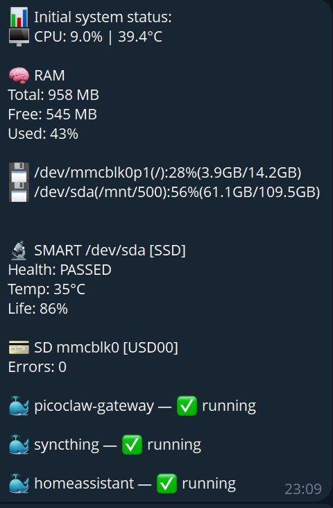

# bpimon

[](https://github.com/Kovalenkoyo81/bpimon/actions/workflows/ci.yml)
[](https://github.com/Kovalenkoyo81/bpimon/releases/latest)
[](go.mod)
[](LICENSE)

A lightweight Telegram bot that watches a Linux machine and tells you when something goes wrong.
It was built for single-board computers (Raspberry Pi, Orange Pi, Banana Pi) and works on any Linux server, VPS or desktop.

One static binary, no runtime dependencies, about 11 MB of RAM.



## Contents

- [Features](#features)
- [Quick start](#quick-start)
- [How alerts work](#how-alerts-work)
- [Bot commands](#bot-commands)
- [Configuration](#configuration)
- [Operations](#operations)
- [Troubleshooting](#troubleshooting)
- [Development](#development)

## Features

**Monitoring**
- CPU usage, temperature and the top processes
- RAM and disk usage per partition
- SMART drive health: status, temperature, remaining life
- SD/MMC card errors from the kernel log
- Docker containers and the Docker daemon

**Alerts**
- Threshold alerts with a reminder cooldown and a recovery message
- A stopped container asks whether it was stopped on purpose, with buttons to answer
- Alert state survives restarts
- `/silence` for maintenance windows
- Announces new bpimon releases

**Remote control**
- Restart containers, reboot or power off the machine, each with a one-time confirmation code
- Admin-only commands and per-user rate limiting

**Platforms:** `amd64`, `arm64`, `armv7`, `armv6`.

## Quick start

You need:
- a bot token from [@BotFather](https://t.me/botfather);
- the chat ID the bot should post to. For a group it is a negative number; forward any message from the group to [@userinfobot](https://t.me/userinfobot) to see it;
- your Telegram user ID, to be an admin. [@userinfobot](https://t.me/userinfobot) shows it too.

Install the latest release as a systemd service. The script detects the architecture and verifies every download against the release's `sha256sums.txt` before installing anything:

```bash
export BPIMON_TELEGRAM_TOKEN=123456:ABC...
export BPIMON_TELEGRAM_CHATID=-1001234567890
export BPIMON_TELEGRAM_ADMINS=123456789
curl -fsSL https://github.com/Kovalenkoyo81/bpimon/releases/latest/download/install.sh | sudo -E bash
```

Then point the config at your hardware and restart:

```bash
sudo nano /etc/bpimon/config.yaml
sudo systemctl restart bpimon
```

The bot posts a startup message with its version, the current system status and the command menu.

> In a group chat, turn off privacy mode in @BotFather (`/setprivacy` → Disable), otherwise the bot does not see commands.

<details>
<summary><b>Build from source on the machine itself</b></summary>

Requires Go (the version in [go.mod](go.mod) or newer). Suits faster boards: Raspberry Pi 3/4/5, Orange Pi, Banana Pi.

```bash
git clone https://github.com/Kovalenkoyo81/bpimon.git
cd bpimon
cp config.yaml.example config.yaml   # edit devices
export BPIMON_TELEGRAM_TOKEN=... BPIMON_TELEGRAM_CHATID=... BPIMON_TELEGRAM_ADMINS=...
sudo -E make install
```

`make install` builds the binary, installs it to `/usr/local/bin`, writes the config and credentials to `/etc/bpimon` and starts the service.

</details>

<details>
<summary><b>Cross-compile and deploy from another machine</b></summary>

Recommended for slow boards (Raspberry Pi Zero, Pi 1, Pi 2): the build takes seconds on a laptop. Requires Go locally and root SSH access to the target.

```bash
cp config.yaml.example config.yaml   # edit devices
export BPIMON_TELEGRAM_TOKEN=... BPIMON_TELEGRAM_CHATID=... BPIMON_TELEGRAM_ADMINS=...
make deploy SERVER=root@your-board                          # arm64 (default)
make deploy SERVER=root@your-board GOARCH=arm GOARM=7       # armv7: Pi 2/3 32-bit, Orange Pi, Banana Pi
make deploy SERVER=root@your-board GOARCH=arm GOARM=6       # armv6: Pi 1, Zero
make deploy SERVER=root@your-board GOARCH=amd64             # x86_64
```

`make deploy` overwrites the remote `config.yaml` and `/etc/bpimon/env` with your local ones.

</details>

## How alerts work

Every `interval_min` minutes bpimon checks each alert:

| Alert | Fires when |
|---|---|
| CPU | usage ≥ `cpu` % since the previous check; includes the top processes |
| CPU Temp | temperature ≥ `cpu_temp` °C |
| Memory | RAM usage ≥ `ram` % |
| Disk | any partition ≥ `disk` % |
| SMART | health is not PASSED, temperature ≥ `smart_temp` °C, or remaining life ≤ `smart_life` % |
| SD | the kernel log has errors for the card |
| Docker container | the container is not running, or was removed |
| Docker daemon | the daemon does not respond |

**Lifecycle.** When a condition appears, bpimon sends 🚨. While it lasts, it repeats the alert every `cooldown_min` minutes. When it clears, it sends ✅ *back to normal*.

**Stopped containers.** A stopped container may have been stopped on purpose, so the alert asks:

- **✋ Stopped by admin**: bpimon stays silent until the container runs again, with no ✅ afterwards.
- **💥 Crashed**: reminders continue every `cooldown_min` until it recovers, then ✅.
- No answer: the question is repeated every `cooldown_min`. Only the latest question keeps its buttons.

Only admins can answer. If the container stops again later, that is a new incident and bpimon asks again right away.

**When a check cannot run.** If a value cannot be read (smartctl fails, the Docker daemon is down, a command times out after 10 s), the alert keeps its previous state: no false ✅ and no false 🚨. The reason is logged once. While the Docker daemon is down, a single *Docker daemon unavailable* alert replaces the alerts of the individual containers.

**State.** With `-state` (the systemd unit sets it), active alerts, answers and open questions are saved to `/var/lib/bpimon/alert_state.json` on every change, so a restart or an update does not repeat known alerts.

**Silence.** `/silence 60` mutes all alerts for an hour; bpimon tells you when the silence ends. Silence is not kept across restarts.

**Updates.** Once a day bpimon checks the latest GitHub release and announces a newer version once, with its release notes. It never updates itself.

## Bot commands

| Command | Description |
|---|---|
| `/status` | Full system status |
| `/cpu` | CPU usage (0.5 s sample), temperature, top processes |
| `/ram` | RAM usage |
| `/disk` | Disk usage per partition |
| `/smart` | SMART drive health |
| `/sd` | SD card status |
| `/docker` | Docker daemon and container status |
| `/restart <name>` | Restart a container (4-digit confirmation code) 🔒 |
| `/reboot` | Reboot the machine (6-digit confirmation code) 🔒 |
| `/poweroff` | Shut down the machine (6-digit confirmation code) 🔒 |
| `/silence <minutes>` | Silence alerts, up to 7 days 🔒 |
| `/silence off` | Resume alerts 🔒 |
| `/silence` | Show silence status 🔒 |
| `/version` | bpimon version, build, uptime and the latest release |
| `/help` | Command menu, with a `/restart_<name>` shortcut per container |

🔒 Admin only: the sender's ID must be in `BPIMON_TELEGRAM_ADMINS`. The alert buttons are admin-only too. Confirmation codes expire after 60 s. Each user can send 5 commands per 10 s.

## Configuration

bpimon reads `/etc/bpimon/config.yaml`. The Telegram credentials normally come from `/etc/bpimon/env` (mode 600) rather than from the config file.

```yaml
telegram:
  enabled: true            # false: print alerts to stdout instead (for testing)
  # token: ...             # usually set via BPIMON_TELEGRAM_TOKEN
  # chat_id: -100...       # usually set via BPIMON_TELEGRAM_CHATID
  # admins: [123456789]    # usually set via BPIMON_TELEGRAM_ADMINS

thresholds:
  cpu: 85                  # % CPU usage
  cpu_temp: 70             # °C
  ram: 90                  # % RAM usage
  disk: 85                 # % usage of any partition
  smart_temp: 55           # °C drive temperature
  smart_life: 20           # % remaining drive life
  interval_min: 2          # minutes between checks
  cooldown_min: 30         # minutes between reminders of an active alert

devices:
  smart:                   # block devices for SMART (needs smartmontools)
    - /dev/sda
  mmc:                     # SD cards; optional, cards are auto-discovered
    - mmcblk0
  docker:                  # containers to watch (needs the docker CLI)
    - bpi-auto-discover    # all containers running when bpimon starts
    # - my-container       # or list names instead
```

| Key | Example default | Notes |
|---|---|---|
| `telegram.enabled` | `true` | Must be set explicitly; an omitted key means `false` |
| `telegram.token`, `chat_id`, `admins` | — | Overridden by the environment variables below |
| `thresholds.cpu` | `85` | % |
| `thresholds.cpu_temp` | `70` | °C |
| `thresholds.ram` | `90` | % |
| `thresholds.disk` | `85` | % |
| `thresholds.smart_temp` | `55` | °C; required if `devices.smart` is set |
| `thresholds.smart_life` | `20` | %, 0–100 |
| `thresholds.interval_min` | `2` | minutes, > 0 |
| `thresholds.cooldown_min` | `30` | minutes, > 0 |
| `devices.smart` | `[/dev/sda]` | Skipped with a warning if `smartctl` is missing |
| `devices.mmc` | auto | Names like `mmcblk0` |
| `devices.docker` | `[bpi-auto-discover]` | Auto-discovery runs once at startup; restart bpimon to pick up new containers |

### Environment variables

| Variable | Description |
|---|---|
| `BPIMON_TELEGRAM_TOKEN` | Bot token from @BotFather |
| `BPIMON_TELEGRAM_CHATID` | Chat to post to (negative for groups) |
| `BPIMON_TELEGRAM_ADMINS` | Comma-separated admin user IDs |
| `BPIMON_DEBUG` | Any value: debug logging, including full bot responses |

### Command-line flags

| Flag | Default | Description |
|---|---|---|
| `-config` | `config.yaml` | Path to the config file |
| `-state` | none | Alert state file; without it, state is not kept across restarts |
| `-version` | | Print version, build date and platform, then exit |

The systemd unit runs `bpimon -config /etc/bpimon/config.yaml -state /var/lib/bpimon/alert_state.json`.

## Operations

**Logs**

```bash
journalctl -u bpimon -f                                   # follow
journalctl -u bpimon --since today | grep -E 'level=(WARN|ERROR)'  # problems only
```

Logs are structured (`log/slog`), one event per line. The level is part of the text, so filter by `level=` rather than with `journalctl -p`:

```
time=2026-11-09T22:37:51.306Z level=INFO msg="alert state loaded" path=/var/lib/bpimon/alert_state.json
time=2026-11-09T23:10:02.114Z level=WARN msg="alert state unknown" alert="Docker app" reason="docker daemon unavailable: ..."
```

**Updating.** The bot announces new releases. To install one, re-run the install command from [Quick start](#quick-start) with the same environment variables. The config and the alert state are kept; the credentials file is rewritten from the variables.

**Files**

| Path | Contents |
|---|---|
| `/usr/local/bin/bpimon` | Binary |
| `/etc/bpimon/config.yaml` | Configuration |
| `/etc/bpimon/env` | Telegram credentials (mode 600) |
| `/var/lib/bpimon/alert_state.json` | Alert state |
| `/etc/systemd/system/bpimon.service` | systemd unit |

**Uninstall**

```bash
sudo systemctl disable --now bpimon
sudo rm -rf /usr/local/bin/bpimon /etc/bpimon /var/lib/bpimon /etc/systemd/system/bpimon.service
sudo systemctl daemon-reload
```

## Troubleshooting

**The bot does not answer commands.** Check `systemctl status bpimon` and the logs. In a group, disable privacy mode in @BotFather (`/setprivacy` → Disable). Commands from other chats are ignored: check `BPIMON_TELEGRAM_CHATID`.

**"Only admins can …".** Add your user ID to `BPIMON_TELEGRAM_ADMINS` in `/etc/bpimon/env` and restart.

**Alert buttons spin and nothing happens.** Update to v1.7.0 or newer; older versions did not request button presses from Telegram.

**"SMART unavailable".** Install smartmontools (`apt install smartmontools`). Without `smartctl`, SMART is skipped with a warning in the log.

**"docker not found".** The `docker` CLI must be in root's `PATH`. Without it, Docker monitoring is skipped with a warning.

**A new container is not monitored.** `bpi-auto-discover` looks for containers once at startup. Restart bpimon: `systemctl restart bpimon`.

**No CPU temperature.** bpimon reads `/sys/class/thermal/thermal_zone*` and prefers zones whose type contains `x86_pkg_temp`, `k10temp`, `cpu`, `soc`, `ap`, `arm`, `pkg`, `core` or `acpi`, in that order. If your board uses another name, please open an issue with the output of `cat /sys/class/thermal/thermal_zone*/type`.

**"state unknown" in the log.** A check could not read its value: a command failed or timed out, or the Docker daemon is down. The alert keeps its last state until the value can be read again.

## Development

- [docs/ARCHITECTURE.md](docs/ARCHITECTURE.md): packages, data flow, alert lifecycle.
- [docs/CONTRIBUTING.md](docs/CONTRIBUTING.md): local setup, checks, conventions, releases.
- [CHANGELOG.md](CHANGELOG.md).

## License

MIT, see [LICENSE](LICENSE).
