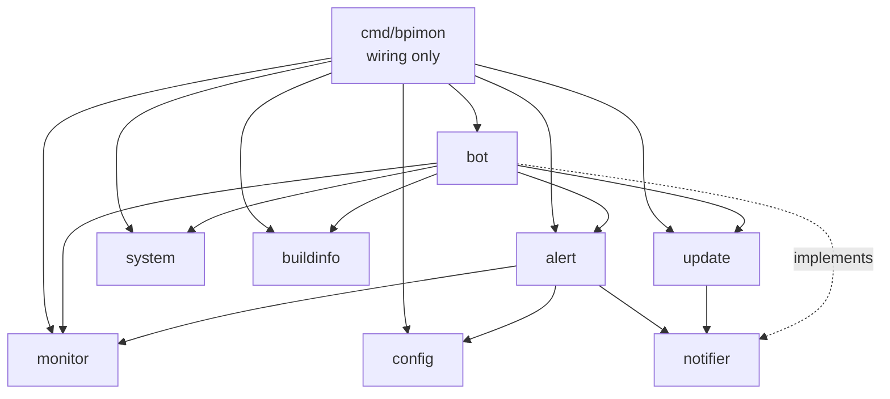
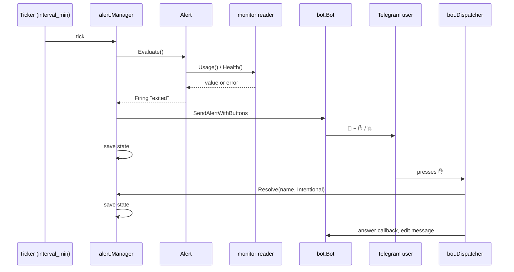
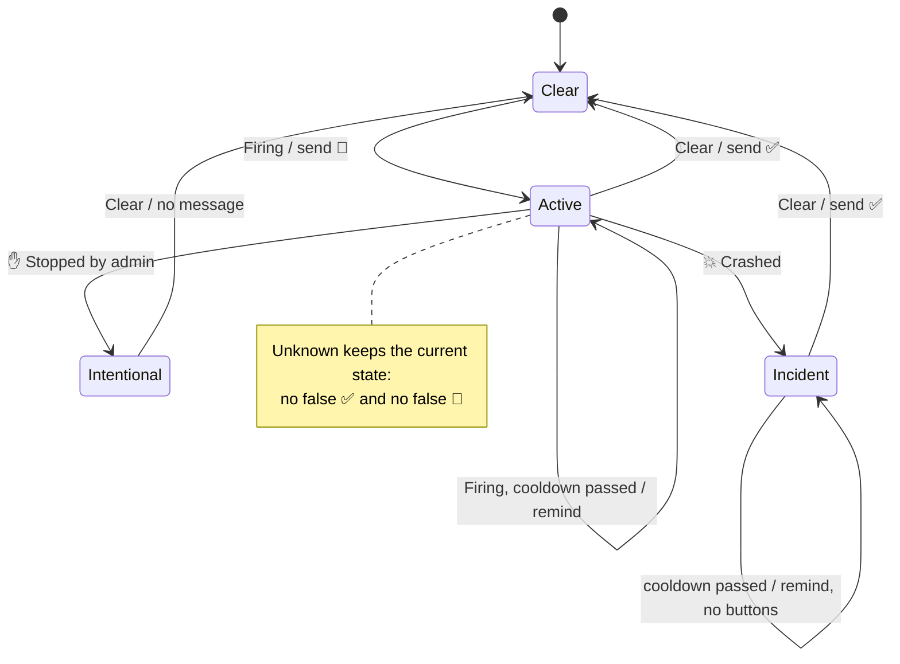

# Architecture

bpimon is a single Go binary. It has two loops: the **alert manager** checks conditions on a timer, and the **dispatcher** answers Telegram updates. They share the metric providers and the alert state.

Every concern lives in its own small type and file. Packages depend on each other only through small interfaces, declared where they are used.

## Packages



| Package | Responsibility |
|---|---|
| `cmd/bpimon` | Parses flags, loads config, builds every component, runs the loops, shuts down on SIGINT/SIGTERM. No logic. |
| `internal/config` | Loads YAML, applies `BPIMON_*` environment overrides and validates. Returns errors; never exits. |
| `internal/monitor` | **Providers**: read metrics (CPU, RAM, disk, SMART, SD, Docker) and render a status line. All external commands go through `output()`, which has a 10 s timeout. |
| `internal/alert` | **Alerts** evaluate one condition each. The **Manager** schedules checks, applies cooldown and silence, asks questions for ambiguous alerts and persists state. |
| `internal/bot` | Telegram: the API wrapper, the **Dispatcher** that routes updates, the command **Handler** and the button **CallbackHandler**. |
| `internal/system` | Host actions: reboot, poweroff, docker restart/inspect, each with a timeout. |
| `internal/update` | Finds the latest GitHub release, compares versions and announces each new release once. |
| `internal/notifier` | `Notifier`, `AlertSender` and `ButtonSender` interfaces, and `Dummy` for running without Telegram. |
| `internal/buildinfo` | Version, build date and uptime of the running binary. |

Only `bot` and `cmd/bpimon` import the Telegram library.

## Key interfaces

```go
// monitor: a metric source shown by commands
type Provider interface {
    Name() string
    Kind() Kind              // commands select providers by Kind, never by name
    Status() (string, error)
}

// alert: one monitored condition
type Alert interface {
    Name() string
    Evaluate() (Verdict, string) // Clear | Firing | Unknown, plus message or reason
}

// alert: optional, for conditions that may be intentional
type Askable interface {
    Choices() (intentional, incident string)
}

// notifier: optional, for channels that support inline buttons
type ButtonSender interface {
    SendAlertWithButtons(text string, buttons []Button) (messageID int, err error)
    ClearButtons(messageID int) error
}
```

Optional capabilities (`Askable`, `ButtonSender`, `Availabler`) are detected with type assertions, so the base interfaces stay small.

## Data flow



## Alert lifecycle



- Only `Askable` alerts (Docker containers) can reach `Intentional` or `Incident`.
- A new incident of an `Askable` alert is asked about right away, even within the cooldown of the previous one.
- Only the latest question keeps its buttons; the manager clears older ones when it sends a reminder, on recovery and on answer.
- Button presses on stale messages re-check the condition instead of trusting cached state.

## State

`alert.Manager` keeps per-alert maps: active, last sent, resolution, open question message ID. `state.go` writes them as JSON on every change, atomically (temp file, fsync, rename), and once more on shutdown. `main` waits up to 5 s for the manager to finish before exiting. Silence is in memory only.

## Concurrency

- The manager loop, the dispatcher and the update watcher run in separate goroutines, all stopped by one context from `signal.NotifyContext`.
- `alert.Manager` guards its maps with a mutex and serialises state writes with a second one. Sending to Telegram and running checks happen outside the lock.
- `monitor.CPU` is shared by the alert loop and commands: `Usage()` keeps the alert's baseline under a mutex, and `Status()` samples its own 500 ms window.
- Container restarts run in a goroutine and report back through the notifier.

## Error handling

- A failed read becomes `Unknown`, never `Clear`. The manager logs the transition into and out of `Unknown` once.
- Telegram send errors are logged in `bot.Send`; fire-and-forget callers may ignore the returned error.
- Only `main` exits the process. Libraries return errors.

## Adding a metric

1. **Provider** in `internal/monitor`: a reader method that returns data, `Name()`, `Status()` and a new `Kind` in `kind.go`. Use `output()` for any external command. Implement `Available()` if it depends on a tool that may be missing.
2. **Register** it in `monitor.NewProviders`.
3. **Alert** in `internal/alert`: `Evaluate()` returning `Unknown` with the error as reason when the read fails. Add it to `alert.FromProviders`.
4. **Command** (optional): a `case` in `bot/router.go` that calls `h.collect(monitor.KindX)`, and a line in `bot/menu.go`.
5. **Tests**: table tests for the alert with a stub reader, including the read-error case.
